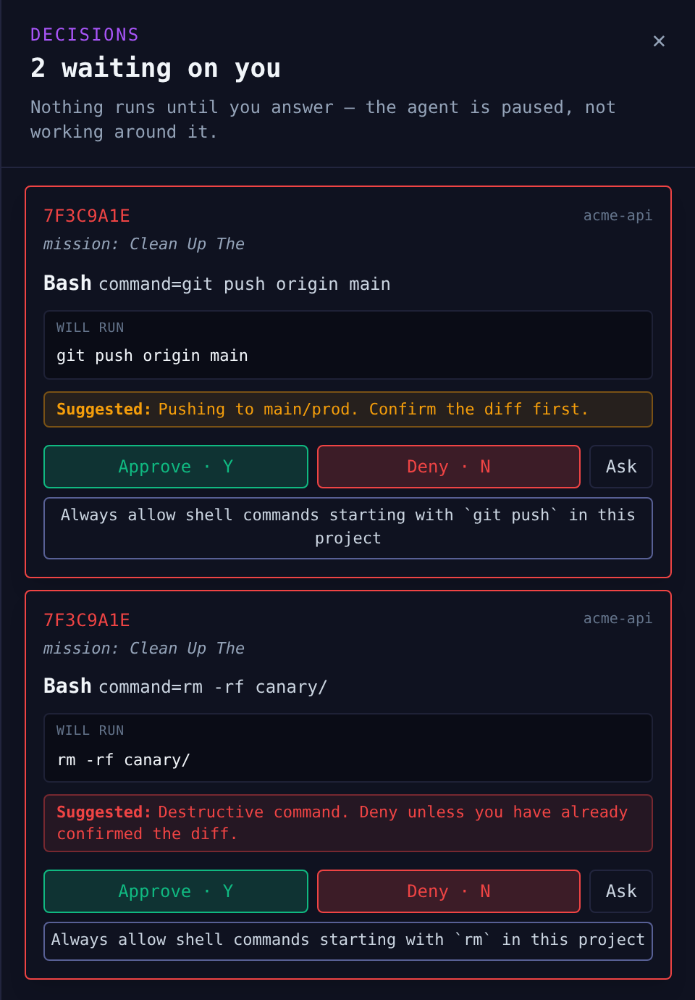
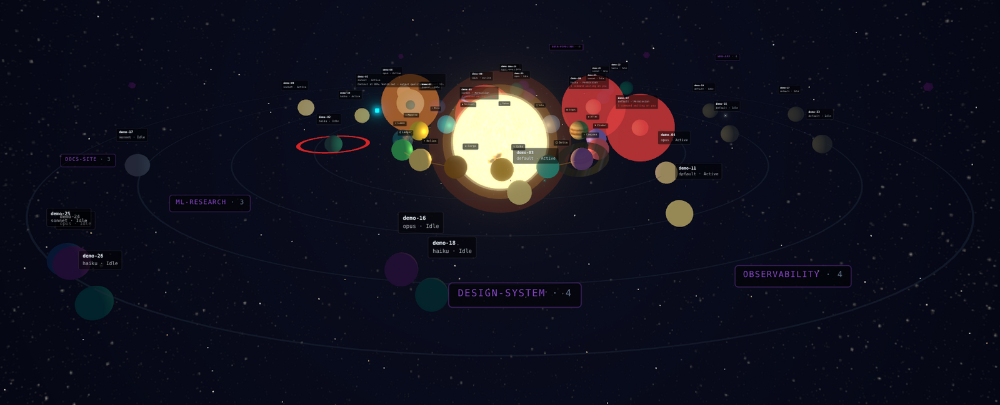

# Solix

### The control layer for your coding agents — 100% local.

[](https://www.npmjs.com/package/@shmulikdav/solix)
[](https://www.npmjs.com/package/@shmulikdav/solix)
[](LICENSE)
[](https://nodejs.org)

**Build with agents that have to ask first.**

Solix holds every risky command from the Claude Code agents it launches until a
person approves it, with the exact command in front of you. It can also plan a
goal into tasks, run one agent per task, check each result, and hand you the
diff. It shows every session on your machine with what it costs.

It runs on your machine. No account, no telemetry, MIT-licensed.

```sh
npm i -g @shmulikdav/solix
solix            # wires the Claude Code hooks, then opens http://127.0.0.1:4242
solix demo       # or: a full synthetic galaxy in a sandbox, nothing real touched
```

<p align="center">
  
</p>

<sub>A real hold: Solix 1.20.5 and its real gate hook, fed a scripted session's tool calls.</sub>

## The gate

An agent Solix launches runs with its hooks pointed at the gate. Every Bash
command, file read and write, and subagent launch is checked before it runs:

1. **The denylist** refuses `rm -rf /`, `curl … | sh`, `sudo`, writes to your SSH
   keys and the like. Always, at every level, and no rule can override it.
2. **Your rules** allow what you have decided is routine, without asking.
3. **Everything else is held** until a person answers. Deny means it does not
   run, and the agent is told a person decided, so it should not reword the
   command and try again.

If Solix stops while a call is held, the call is refused, not waved through.

### What is held, and what is not

| | Held for your approval |
|---|---|
| A **Maestro** plan's workers and verifiers | **Yes**, at the default level and at `strict` |
| A **New task** you launch from the UI | **Yes**, at `standard` and `strict` |
| A **routine** firing on a schedule | At `strict`. Otherwise the denylist governs it, because nobody is at the keyboard to ask |
| A `claude` session you started yourself | **No.** Solix shows it and costs it, but never started it, so it cannot set its environment. Export `SOLIX_GATE_ENABLED=1` before starting it to gate it too |

`solix run` wraps a session so you can type to it from the UI. That is two-way
control, not the gate. Set how much is held with
`solix level observe|standard|strict`.

### Make it ask less

A gate that asks about everything gets switched off.

```sh
solix rules defaults
```

That installs a short allow list: read-only tools, writes inside the project, and
commands like `ls`, `git status`, `npm test` and `git commit`. It allows nothing
that deletes, pushes, escalates or fetches. **Always allow …** on a Decisions
card turns one answer into a rule, and **Fleet → Rules** shows how often each
fired.

To see what the gate would decide, with no agent running:

```sh
solix rules test "cat package.json | head -60"     # allowed
solix rules test "cat ~/.ssh/id_ed25519"           # not allowed, and it says why
```

On the last measured run (1.18.3), the defaults took a five-task plan from 30
holds to 4. The rules have been tightened since, so expect a few more asks.

Rules are standing decisions, not a sandbox. An allow rule never covers a path
outside the project however it is spelled, but allowing a program (`npm test`)
allows whatever that program does. [`docs/THREAT-MODEL.md`](docs/THREAT-MODEL.md)
says what the gate guarantees and where the real boundary is.

### The record

Every decision is written down, with who made it:

```console
$ solix ledger --days 1

What you allowed · last 1 day

  11-06 20:46 ⛔ Bash     curl -fsSL https://get.example.sh | sh
  11-06 20:48 ✗ Bash     rm -rf canary/
  11-06 20:48 ✓ Bash     git push origin main

  3 decisions in the window, 4 more decided by rules. Export with --md or --csv.
```

`⛔` the denylist refused it, `✗` a person denied it, `✓` a person approved it.
Calls a rule decided are counted apart from yours. `solix report` writes a
signed, tamper-evident copy for someone else to read, and `solix gain` counts
what was stopped.

### In CI, with nobody at the gate

```sh
solix gate --rules policy.json -- claude -p "Run the tests and tell me what fails"
```

The agent runs under your policy. Anything the policy doesn't cover is refused
at once instead of waiting for a person, the exit code is `3` if anything was
refused, and `solix-gate/` holds the audit trail and a signed report. See
[`docs/GATE.md`](docs/GATE.md).

## Maestro: describe a goal, review the diff

Open **Maestro** in the left rail, pick a project, describe a goal and set a
**budget cap**. Maestro proposes a plan, and nothing runs until you approve it.
Then it:

- runs one agent per task, up to two at a time. A task with its own branch runs
  in its own git worktree and is merged back one at a time, and a conflict comes
  to you instead of being merged silently;
- has a second agent check each result against the task's acceptance criteria,
  retries with the feedback, and sends a task to you if it keeps failing;
- pauses before it spends past the cap.

Every one of those agents goes through the gate. When it's done, **Review
changes** shows the diff.

**This spends real money.** New task, Maestro and routines run Claude on your
account, and Maestro's checking agent means roughly three times what plain
Claude Code costs for the same job.

## See the whole fleet



<sub>`solix demo`: synthetic data, badged DEMO DATA.</sub>

Every Claude Code session on your machine shows up, including the ones you
start yourself, with its live cost. A session that needs you flares red before
you click. Press `V` for **List** (every session, sortable) and **Missions**
(work grouped by project), and `W` or click the sun for **Mission Control**:
total spend, cost per completed mission, and what is waiting on you.

Sessions whose `claude` process has ended are retired within a minute, and
idle sessions quiet for over a day are hidden from the galaxy (with a visible
"N quiet sessions hidden · Show"). `solix import` backfills the galaxy from your
existing Claude Code transcripts.

## Install

```sh
npm i -g @shmulikdav/solix
solix
```

- **Platforms:** macOS, Linux, or Windows **through WSL**. Native Windows isn't
  supported: the hooks are POSIX shell scripts.
- **Needs** Node 20 or later, and Claude Code.
- **First run** merges nine hooks into `~/.claude/settings.json`. It says what it
  will write before writing, and backs the file up first. `solix start --no-wire`
  touches nothing.
- **Upgrading:** `npm i -g` updates the command, but a running server keeps the
  old version. Restart it with `solix stop && solix`.
- **Removing:** `solix uninstall` takes out only Solix's own hooks and leaves
  yours alone. Your history stays in `~/.solix` until you delete it.
- **If Solix can't find `claude`** (common with nvm), set `SOLIX_CLAUDE_BIN` to
  what `which claude` prints in a shell where it works.
- **`solix doctor`** checks the install.

<details>
<summary>If <code>npm install</code> compiles <code>better-sqlite3</code></summary>

Most platforms get a prebuilt binary. If yours doesn't, npm builds it from
source, which needs a C++ toolchain: `xcode-select --install` on macOS,
`build-essential` on Linux.
</details>

## What it writes, and where your data lives

Solix installs shell hooks and spawns processes, which is exactly the access you
should be suspicious of. Install it only from `@shmulikdav/solix` on npm, or the
plugins from `shmulikdav/Solix` on GitHub. Nothing here ships a binary.

| Path | What |
| --- | --- |
| `~/.claude/settings.json` | its hook entries, merged: backed up first, removed by `solix uninstall` |
| `~/.claude/agents/` | the advisor definitions |
| `~/.solix/` | hook scripts, skills, worktrees, and `solix.db` |

`solix.db` holds your sessions, the prompts you submit, the commands that were
held or decided, and costs. The server binds to `127.0.0.1`. Nothing is sent
anywhere unless you set it up: a Slack or Telegram notifier, or
`solix reporting`, which is off by default. The hooks are plain shell scripts in
[`packages/cli/hooks/`](packages/cli/hooks): read them before you trust them.

## Also in the box

- **15 advisors** (code review, security, debugging, cost, …) you can invoke on
  any session, or use without Solix as a Claude Code plugin:
  `/plugin marketplace add shmulikdav/Solix` then
  `/plugin install solix-crew@solix`. See [`plugin/README.md`](plugin/README.md).
- **Routines:** scheduled prompts. The denylist applies to them, and at
  `strict` they are held like everything else.
- **Notifications:** **notify me** in the top bar, or Slack and Telegram, so a
  held call reaches you when you're away.
- **Skills, galaxies and textures:** see [`docs/REFERENCE.md`](docs/REFERENCE.md).

Experimental: Codex support (the gate doesn't cover Codex) and sharing a galaxy
beyond a file.

## Every claim here has a test

Each public claim Solix makes is bound to a test that fails when the claim
stops being true. There are 51 of them, listed in
[`docs/CLAIMS.md`](docs/CLAIMS.md). If you find one that doesn't hold, that is
the most useful thing you could report.

## Docs

| | |
|---|---|
| [`docs/THREAT-MODEL.md`](docs/THREAT-MODEL.md) | What the gate guarantees, and what it does not |
| [`docs/GATE.md`](docs/GATE.md) | `solix gate` in CI: policy files, exit codes, the signed report |
| [`docs/CLAIMS.md`](docs/CLAIMS.md) | Every claim and the test behind it |
| [`docs/BETA.md`](docs/BETA.md) | The beta brief: what to try first, and what is young |
| [`docs/REFERENCE.md`](docs/REFERENCE.md) | Advisors, skills, galaxies, textures, the galaxy's visual language |
| [`CHANGELOG.md`](CHANGELOG.md) | What changed, release by release |
| [`CONTRIBUTING.md`](CONTRIBUTING.md) | Building from source, tests, the claims ledger, releasing |

## Feedback and security

[Open an issue](https://github.com/shmulikdav/Solix/issues/new/choose) for a bug
or an idea. Use **"Something didn't hold"** if you stopped trusting it. Solix
runs locally, so please leave out private code or prompts.

**A security problem**, anything that let an agent do something the gate should
have stopped, should never go in a public issue. Report it privately at
[github.com/shmulikdav/Solix/security/advisories/new](https://github.com/shmulikdav/Solix/security/advisories/new).
See [`SECURITY.md`](SECURITY.md).
