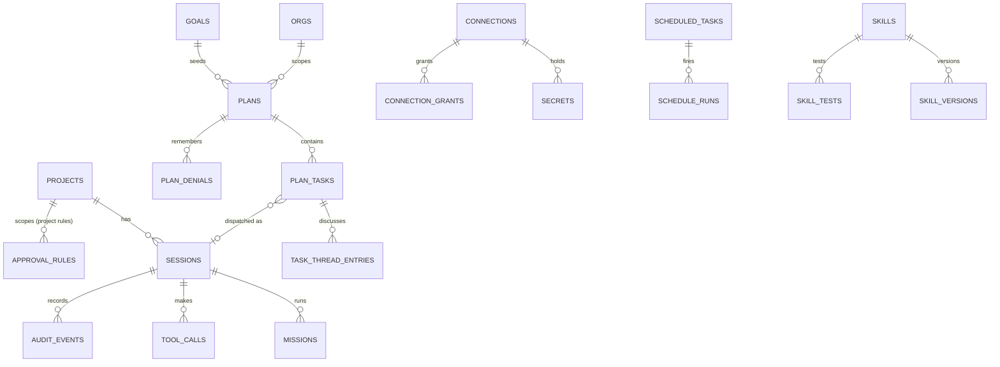

# 03 · Product Requirements Document

[← Package index](README.md) · Previous: [02 · Vision & strategy](02-product-vision-and-strategy.md) · Next: [04 · Feature inventory](04-feature-inventory.md)

**Product:** Solix (`@shmulikdav/solix`) · **Document state:** reverse-engineered from the implementation on 2026-11-03 · **Covers version:** 1.20.3 (`main` `9091b59`)

This PRD describes **what the product does and is required to do**, as recovered from code, tests and documents. It is not a record of approved future scope; that is in [08 · Backlog](08-backlog-and-roadmap.md). Where the PRD's 16 sections are better served by a dedicated document, the section links there instead of repeating it.

| PRD section | Where |
|---|---|
| 1 · Executive summary | [01](01-executive-summary.md) |
| 2 · Vision & strategy | [02](02-product-vision-and-strategy.md) |
| 3 · Users, personas & use cases | [below](#3-users-personas--use-cases) |
| 4 · Feature inventory | [04](04-feature-inventory.md) |
| 5 · User journeys | [05](05-user-journeys.md) |
| 6 · Functional requirements | [below](#6-functional-requirements) |
| 7 · Non-functional requirements | [below](#7-non-functional-requirements) |
| 8 · Architecture & integrations | [06](06-technical-architecture.md) |
| 9 · Data model & business logic | [below](#9-data-model--business-logic) |
| 10 · Current status | [07](07-current-status.md) |
| 11 · Backlog & roadmap | [08](08-backlog-and-roadmap.md) |
| 12 · Risks & technical debt | [09](09-risks-and-technical-debt.md) |
| 13 · Analytics & success measurement | [below](#13-product-analytics--success-measurement) |
| 14 · Decisions & history | [10 Part 1](10-decisions-and-open-questions.md#part-1--decisions) |
| 15 · Dependencies & ownership | [below](#15-dependencies--ownership) |
| 16 · Open questions | [10 Part 2](10-decisions-and-open-questions.md#part-2--open-questions) |

---

## 3. Users, personas & use cases

**No user research exists.** The personas below are derived from the product's documentation (`README.md`, `DEMO*.md`, `docs/GATE.md`, `docs/TEAMS-SPEC.md`) and from what the code supports. They carry no demographic detail, because none is known.

### 3.1 Roles in the product

Solix has **no user accounts and no login**. It is a single-user local tool. "Roles" are about *what is acting*, not *who is logged in*:

| Role | What it is | Permissions |
|---|---|---|
| **The person at the desk** | Whoever can reach `http://127.0.0.1:4242`, in practice the machine's user | Everything: approve and deny, configure, launch, delete |
| **A session you started** (`origin: external`) | A `claude` run by the user in a terminal | Observed and costed; **not gated** unless `SOLIX_GATE_ENABLED=1` |
| **A Solix-launched session** (`origin: internal`, roles `worker` / `verifier` / `planner` / `routine`) | An agent started by Maestro, New task or a routine | Gated fail-closed. Workers, verifiers and routines are also **contained**: the floor applies and file writes outside the project are refused |
| **A headless gate run** | An agent under `solix gate` | Gated fail-closed; anything uncovered is refused |
| **Local processes** | Anything else on the machine | Need the token in `~/.solix/token` to post events; the browser UI uses the WebSocket |

**Multi-user use is not supported.** Decisions aren't attributed to a person, and there is no RBAC (role-based access control). "Several people at the gate" is planned ([F-80](04-feature-inventory.md)).

### 3.2 Personas

| Persona | Goal | Pains Solix addresses | Primary features | Evidence |
|---|---|---|---|---|
| **P1 · The multi-agent developer** (primary) | Run several Claude Code sessions without losing track or getting burned | Missed permission prompts, invisible spend, fear of a destructive command | Galaxy, Decisions, the band, cost, the gate, rules | `README.md`, `DEMO_DEV.md` |
| **P2 · The delegating builder** | Hand a goal to a fleet and review the result | Coordinating tasks, verifying output, keeping risk in check | Maestro, worktrees, budget caps, review diff | `README.md` § Maestro, `docs/EVAL.md` |
| **P3 · The team / CI owner** | Run agents unattended under the same policy as at the desk, with a record | CI runs that are either ungated or stall; no audit artifact | `solix gate`, policy files, `rules test`, signed report | `docs/GATE.md`, [D-07](10-decisions-and-open-questions.md#d-07) |
| **P4 · The organisation / auditor** (future) | Prove what agents were allowed to do across a fleet | No fleet-wide record or central policy | Ledger, signed report, reporting client; the Teams server is **not built** | `docs/TEAMS-SPEC.md`, `docs/MONETISATION.md` |
| **P5 · The PM / non-developer observer** (secondary) | Understand what agents are doing and costing | Opacity | Galaxy, Mission Control, the PM advisor | `DEMO_PM.md` |

### 3.3 Core jobs to be done

1. *When an agent is about to do something irreversible, I want to be asked first, so a mistake doesn't cost me.* (P1, P2, P3)
2. *When I'm not watching, I want risky actions refused rather than allowed.* (P1, P3)
3. *When I run several agents, I want one place that shows who needs me and what it costs.* (P1, P5)
4. *When I have a larger goal, I want it split, run and checked without me orchestrating each step.* (P2)
5. *When someone asks what our agents did, I want a record I can hand over.* (P3, P4)
6. *When I've decided once, I want to stop being asked.* (P1, P2, P3)

### 3.4 Major use cases

| ID | Use case | Trigger | Preconditions | Expected behaviour | Success outcome | Exceptions |
|---|---|---|---|---|---|---|
| UC-1 | **Watch my sessions** | The user runs `claude` | Solix installed; server running | A planet appears within about a second; cost and context update live | The user sees all sessions and their spend | Server not running: hooks fail open, no planet ([J-02](05-user-journeys.md#j-02)) |
| UC-2 | **Approve or deny a risky call** | A gated agent calls a sensitive tool | A Solix-launched or `SOLIX_GATE_ENABLED` session; no covering rule | Held with the exact command; Decisions badge, band and notification | Approved: runs. Denied: refused, and sticky for the plan | No answer in 300 s: denied. Solix killed: refused ([J-04](05-user-journeys.md#j-04)) |
| UC-3 | **Stop being asked about routine work** | Too many holds | — | `solix rules defaults` or "Always allow" on a Decisions card | Routine calls are decided by rule and labelled as such in the ledger | A rule never overrides the floor and never covers paths outside the project |
| UC-4 | **Build a goal with Maestro** | The user enters a goal | A project directory (git recommended) | Plan proposed → approved → tasks dispatched, verified and retried → review diff | Working changes in the project, reviewable | Task fails repeatedly: escalated. Budget hit: paused. Deny: escalated, not retried ([J-05](05-user-journeys.md#j-05)) |
| UC-5 | **Run an agent in CI under a policy** | A CI job runs `solix gate` | `claude` installed in CI; a policy file | Covered calls run; others are refused at once; artifact written | Exit 0 with a signed report, or exit 3 listing what was refused | A bad policy exits 2 before the agent runs ([J-07](05-user-journeys.md#j-07)) |
| UC-6 | **Check a policy before running it** | Writing a policy | — | `solix rules test --rules p.json "<cmd>"` | Shows the verdict and the uncovered segment | — |
| UC-7 | **Hand someone a record** | An audit or review | Decisions recorded | `solix ledger --md/--csv`, `solix report` | A signed, verifiable report | A report proves origin and integrity, **not completeness** |
| UC-8 | **Schedule recurring work** | The user creates a routine | — | Fires on an interval, a webhook or manually; cost shown before enabling | Runs logged with history | At `standard`, routines are not held (the floor applies); at `strict`, they are |
| UC-9 | **Try it without risk** | A new user | — | `solix demo` seeds a synthetic galaxy in a sandboxed database | The galaxy is alive in about 10 s | — |

---

## 6. Functional requirements

Requirements are written from the implementation. **Priority** uses the P0/P1/P2 levels assigned in `docs/E2E-SMOKE-TEST.md` where a matching check exists; otherwise "—" (not set by anyone). Status uses the [definitions in 04](04-feature-inventory.md#status-definitions).

### 6.1 Implemented requirements

#### Installation and lifecycle (F-01, F-13, F-14)

| ID | Requirement | Acceptance criteria | Pri | Status | Source |
|---|---|---|---|---|---|
| FR-INS-01 | Solix shall wire its hooks into Claude Code on first run, after backing up the user's settings and disclosing what it will write. | **Given** an existing `~/.claude/settings.json` **when** `solix` first runs **then** a backup exists, the disclosure lists the 9 hooks, and the user's own keys are unchanged. | P0 | Completed & Verified | Smoke A3, A4; `install.test.ts` |
| FR-INS-02 | Solix shall never install a second set of its hooks. | **Given** Solix hooks already installed from another `SOLIX_HOME` **when** Solix installs again **then** each hook appears once. | — | Completed & Verified | `CLAIM-ONE-HOOK-SET` |
| FR-INS-03 | Uninstall shall remove only Solix's entries. | **Given** user hooks plus Solix hooks **when** `solix uninstall` **then** only Solix's are gone. | P0 | Completed & Verified | Smoke O1; `CLAIM-UNINSTALL-RESTORES` |
| FR-INS-04 | An unknown command shall start nothing. | **Given** `solix gaet` **when** run **then** it prints an unknown-command error with a suggestion, exits 1, and starts no server. | — | Implemented, Not Verified | `CLAIM-TYPO-NEVER-STARTS` |
| FR-INS-05 | A second server on a busy port shall refuse to start. | **Given** port 4242 is in use **when** `solix` runs **then** it says nothing was started. | — | Completed & Verified | Smoke ("port already in use") |

#### Observation and cost (F-02 to F-05, F-08 to F-11)

| ID | Requirement | Acceptance criteria | Pri | Status | Source |
|---|---|---|---|---|---|
| FR-OBS-01 | A Claude Code session shall appear in Solix when it starts. | **Given** Solix running **when** `claude` starts in any directory **then** a session exists with its project within ~1 s. | P0 | Completed & Verified | Smoke D1 |
| FR-OBS-02 | Cost shall be computed from the transcript, each line counted once. | **Given** a transcript re-read after a restart **when** cost is recomputed **then** it is unchanged. | P0 | Completed & Verified | `CLAIM-COST-COUNTED-ONCE` |
| FR-OBS-03 | Context usage shall be measured, not seeded. | **Given** a real session **when** it runs **then** `contextUsagePct` is non-zero and from the transcript. | — | Completed & Verified | `CLAIM-CONTEXT-IS-MEASURED` |
| FR-OBS-04 | Solix shall never contact a network destination the user didn't configure. | **Given** a default install **when** Solix runs **then** no outbound request is made. | P0 | Implemented, Not Verified (test-enforced) | `CLAIM-NO-TELEMETRY`; smoke N1 |
| FR-OBS-05 | Agent View sessions shall be mirrored read-only, and an unrecognised state reported as such. | **Given** an unknown `state.json` value **then** the session shows as unrecognised, not guessed. | — | Implemented, Not Verified | `CLAIM-AGENTVIEW-REPORTS-WHAT-IT-SEES` |

#### The gate (F-20 to F-24, F-27)

| ID | Requirement | Acceptance criteria | Pri | Status | Source |
|---|---|---|---|---|---|
| FR-GATE-01 | A sensitive tool call from a Solix-launched agent shall be held for a person, showing the exact command. | **Given** a worker at `standard` and no covering rule **when** it runs `rm canary/keep.txt` **then** a hold shows that exact command, and the file exists while held. | P0 | Completed & Verified | Smoke E2; `CLAIM-GATE-HOLDS-LAUNCHED` |
| FR-GATE-02 | Deny shall prevent the call; Approve shall release it. | **Given** a held call **when** denied **then** the tool is refused and the file survives. **When** approved **then** it runs. | P0 | Completed & Verified | Smoke E3, E4 |
| FR-GATE-03 | With no answer, or Solix unreachable or stopped, a gated call shall be refused. | **Given** two held calls **when** Solix receives SIGTERM **then** both are refused and audited before exit. | P0 | Completed & Verified | Smoke E6; `CLAIM-FAILCLOSED` |
| FR-GATE-04 | The denylist shall refuse catastrophic commands at every level, before any rule, even for an unknown session. | **Given** level `observe` and an allow-all rule **when** `rm -rf ~` is requested **then** it is blocked and audited as `command_blocked`. | P0 | Completed & Verified | Smoke F8; `CLAIM-FLOOR-ALL-LEVELS`, `CLAIM-FLOOR-NO-SESSION`, `CLAIM-RULES-NEVER-OVERRIDE-FLOOR` |
| FR-GATE-05 | A person's deny shall be final for the plan. | **Given** a denied command **when** the same normalised command is requested in that plan **then** it is refused without asking, and the task escalates rather than retries. | P1 | Implemented, Not Verified | `CLAIM-DENY-IS-STICKY`, `CLAIM-DENY-STOPS-RETRY` |
| FR-GATE-06 | A restart shall not answer an open hold. | **Given** a plan with an abandoned hold **when** Solix restarts **then** the plan is `paused`. | P1 | Implemented, Not Verified | `CLAIM-RESTART-PAUSES-ON-HOLD` |
| FR-GATE-07 | Lowering the level under running work shall require intent. | **Given** contained sessions running **when** `solix level observe` **then** it is refused without `--force`. | P1 | Implemented, Not Verified | `CLAIM-DOWNGRADE-NEEDS-FORCE` |
| FR-GATE-08 | Sessions the user started shall not be blocked by Solix. | **Given** an external `claude` **when** it runs a sensitive command **then** Solix observes and does not hold. | P1 | Completed & Verified | Smoke D3 |

#### Approval rules (F-25, F-26, F-29)

| ID | Requirement | Acceptance criteria | Pri | Status | Source |
|---|---|---|---|---|---|
| FR-RULE-01 | Rules shall decide calls after the floor and before a person, with deny winning over allow. | **Given** an allow `git` prefix and a deny `git push` **when** `git push` is requested **then** it is refused by rule. | — | Completed & Verified | `router.rules.test.ts`; eval |
| FR-RULE-02 | A shell command shall be allowed only when every segment is covered. | **Given** an allow `ls` **when** `ls && git push` is requested **then** it is not allowed by rule. | — | Completed & Verified | `rules.test.ts` |
| FR-RULE-03 | An allow rule shall never cover a path outside the project or scratchpad, however spelled. | **Given** the defaults **when** `cat $HOME/.ssh/id`, `cat ../../x`, `echo x >~/.bashrc`, `git log --output=/etc/x` or `Read ~/.ssh/id` is requested **then** none is allowed by rule. | — | In Progress (1.20.3 unpublished) | `CLAIM-RULES-SEE-EVERY-PATH`, `CLAIM-READS-CONFINED`, `CLAIM-RULES-SEE-REDIRECTS`, `CLAIM-ALLOW-RULES-CONFINED` |
| FR-RULE-04 | Rule decisions shall be recorded apart from human decisions. | **Given** 100 rule-allowed calls **when** the ledger counts decisions **then** human decisions are unchanged. | — | Completed & Verified | `CLAIM-AUTO-DECISIONS-LABELLED` |
| FR-RULE-05 | A person shall be able to check what the gate would do with a command. | **Given** a policy **when** `solix rules test --rules p "<cmd>"` **then** the output equals the gate's verdict and names any uncovered segment; exit 0/1/2. | — | Implemented, Not Verified | `CLAIM-RULES-TEST-IS-THE-GATE` |

#### Headless gate (F-28)

| ID | Requirement | Acceptance criteria | Pri | Status | Source |
|---|---|---|---|---|---|
| FR-CI-01 | Under `solix gate`, any uncovered call shall be refused at once and the agent told not to retry. | **Given** a policy without `npm publish` **when** the agent runs it **then** it is refused immediately, with no hold. | — | Completed & Verified | Owner run 2026-11-03; `CLAIM-HEADLESS-FAILS-CLOSED` |
| FR-CI-02 | The run shall exit 3 if anything was refused, unless `--allow-denials`; exit 2 on a bad policy before the agent runs. | as stated | — | Completed & Verified | `gate.test.ts`; owner run |
| FR-CI-03 | The run shall write `audit.json`, a signed `report.json` and `report.md`. | **Given** any run **then** all three exist and the report verifies. | — | Completed & Verified | `gate.test.ts`; owner run |
| FR-CI-04 | A policy shall be able to extend the defaults. | **Given** `{extends:"defaults", rules:[deny git commit]}` **then** `git status` is allowed and `git commit` refused. | — | Implemented, Not Verified | `CLAIM-POLICY-EXTENDS-DEFAULTS` |

#### Maestro (F-41 to F-48)

| ID | Requirement | Acceptance criteria | Pri | Status | Source |
|---|---|---|---|---|---|
| FR-MAE-01 | A goal shall become a plan a person approves before anything runs, unless full-auto is on. | **Given** a goal **when** planned **then** the plan is `awaiting_approval` and no worker exists. | P0 | Completed & Verified | Smoke K1; eval |
| FR-MAE-02 | Each task shall be verified against its acceptance criteria and retried with feedback, then escalated. | **Given** a task failing verification **when** attempts remain **then** it retries with the verifier's feedback; **otherwise** it is `escalated`. | P1 | Completed & Verified (eval) | `retry.test.ts`; `docs/EVAL.md` |
| FR-MAE-03 | A verified task's terms shall not change afterwards. | **Given** a `completed` task **when** its criteria are edited **then** the request is refused. | — | Implemented, Not Verified | `CLAIM-VERIFIED-TERMS-FIXED` |
| FR-MAE-04 | A plan shall pause at or before its budget. | **Given** `budgetUsd=1` **when** spend reaches $1 **then** no new task dispatches and the plan is `paused`. | P0 | Implemented, Not Verified | `CLAIM-BUDGET-PAUSES-BEFORE-THE-CAP` |
| FR-MAE-05 | Full-auto shall be refused unless worker containment is intact. | **Given** `SOLIX_CONTAINMENT=0` **when** full-auto is requested **then** it is refused. | — | Implemented, Not Verified | `/api/system/containment` |
| FR-MAE-06 | Isolated tasks may run in parallel, each in its own worktree, integrated one at a time; a conflict escalates. | **Given** two isolated tasks editing the same file **then** the second escalates and the plan checkout holds only the first change. | — | Implemented, Not Verified | `CLAIM-PARALLEL-INTEGRATES` |
| FR-MAE-07 | The kill switch shall stop a plan's workers. | **Given** a running plan **when** aborted **then** its workers terminate and its worktrees are cleaned up. | P0 | Implemented, Not Verified | Smoke K5 defined |

#### Records (F-30 to F-33)

| ID | Requirement | Acceptance criteria | Pri | Status | Source |
|---|---|---|---|---|---|
| FR-REC-01 | The ledger and its exports shall count every decision in the window, and say so when they list fewer. | as stated | — | Completed & Verified | `CLAIM-LEDGER-COUNTS-EVERYTHING`; smoke |
| FR-REC-02 | A report shall be signed and verifiable. | **Given** a report edited after signing **when** verified **then** verification fails. | — | Implemented, Not Verified | `report.test.ts` |
| FR-REC-03 | Reporting shall be off by default, send only decision metadata, and never lose a record. | **Given** an endpoint down **when** push fails **then** the cursor doesn't advance and records are sent later. | — | Implemented, Not Verified | `reporting.test.ts` |
| FR-REC-04 | History shall never be destroyed without a verified copy first. | as stated | — | Implemented, Not Verified | `CLAIM-RESET-KEEPS-A-COPY` |

#### Configuration and extension (F-49, F-60 to F-66)

| ID | Requirement | Acceptance criteria | Pri | Status | Source |
|---|---|---|---|---|---|
| FR-CFG-01 | Secrets shall be encrypted at rest and never returned by the API. | **Given** a stored secret **when** `GET /api/connections` **then** only key names are returned. | P0 | Implemented, Not Verified | `CLAIM-SECRETS-WRITE-ONLY` |
| FR-CFG-02 | A worker shall see only the connections granted to it. | as stated | P1 | Implemented, Not Verified | `connections.test.ts` |
| FR-CFG-03 | Installing a team template twice shall not double recurring spend. | as stated | — | Implemented, Not Verified | `CLAIM-TEAMS-IDEMPOTENT` |
| FR-CFG-04 | Editing a routine shall keep its id, history and webhook token. | as stated | — | Implemented, Not Verified | `CLAIM-ROUTINE-EDIT-KEEPS-HISTORY` |
| FR-CFG-05 | A disabled item (advisor, routine, notifier) shall not act. | as stated | — | Implemented, Not Verified | `CLAIM-DISABLED-MEANS-DISABLED` |
| FR-CFG-06 | Importing a galaxy from a URL shall not reach internal network addresses. | **Given** a URL resolving to a private address **then** the import is refused. | — | Implemented, Not Verified | `CLAIM-IMPORT-NO-SSRF` |

### 6.2 Outstanding requirements (not implemented)

| ID | Requirement | Rationale | Status | Source |
|---|---|---|---|---|
| FR-NEW-01 | Several people shall be able to claim and answer holds, with decisions attributed to a person. | A team, not one desk, runs the gate | Planned | 1.20 roadmap (owner); [F-80](04-feature-inventory.md) |
| FR-NEW-02 | An agent shall be able to read its own remaining budget, context and rules in force. | Agents stop guessing and retrying blind | Planned | [F-81](04-feature-inventory.md) |
| FR-NEW-03 | Ledger and audit shall export machine-readable JSON (and SIEM). | Team dashboards, compliance | Planned | [F-82](04-feature-inventory.md) |
| FR-NEW-04 | A session whose process has ended shall not count as active. | The headline counter must be true | Proposed | [R-05](09-risks-and-technical-debt.md#r-05) |
| FR-NEW-05 | The Galaxy shall remain readable with hundreds of sessions. | First impression; daily use | Proposed | [F-86](04-feature-inventory.md) |
| FR-NEW-06 | The Codex runtime shall be gated with a human hold. | Second runtime | Blocked | [F-83](04-feature-inventory.md) |
| FR-NEW-07 | A company server shall aggregate reports from many machines. | The business model | Planned | `docs/TEAMS-SPEC.md` |
| FR-NEW-08 | Org scoping shall include routines. | Tenancy is incomplete | Planned (stated gap) | `docs/PARTNER-BRIEF.md` |

---

## 7. Non-functional requirements

The table records what exists. **No SLAs, benchmarks or certifications exist, and none are invented here.**

| ID | Area | Current state | Evidence | Gap / needs validation |
|---|---|---|---|---|
| NFR-01 | **Hook latency** | Every hook time-caps its network call and fails open: 1 s for observability calls, the gate timeout for a held decision. Earlier "~2 ms" marketing was withdrawn as wrong. | `CLAIM-HOOK-OVERHEAD-BOUNDED`; `hookOverhead.test.ts` | No measured p50/p95 per tool call on a real machine |
| NFR-02 | **Shutdown** | Held requests are refused and Solix exits: 24 ms with one hold, 1,956 ms with two, measured | Smoke E6 | Stated as a bound ("well under a second" in the notes), but 1,956 ms was measured. Reconcile ([R-14](09-risks-and-technical-debt.md#r-14)) |
| NFR-03 | **Scale** | Not tuned for large fleets. Selectors and planets memoised in 1.18.3; List not virtualised; one DOM label per planet | `docs/PARTNER-BRIEF.md`; owner screenshot (481 sessions) | No capacity target defined |
| NFR-04 | **Reliability** | Fail-closed gate; restart pauses plans; reporting is idempotent; stale permission holds cleared at start | Claims listed in 04 | Stale *active* sessions are not cleared ([R-05](09-risks-and-technical-debt.md#r-05)) |
| NFR-05 | **Security** | See [06 § Security](06-technical-architecture.md#7-security-mechanisms) and `docs/THREAT-MODEL.md` | 12 security-related claims | No external review or pen-test recorded |
| NFR-06 | **Privacy** | No telemetry; no account; all data local; reporting opt-in and metadata-only | `CLAIM-NO-TELEMETRY`; `state/reporting.ts` | No privacy policy document (not needed while nothing is collected) |
| NFR-07 | **AuthN / AuthZ** | No user auth (single-user local). Ingestion token; loopback binding; Host and Origin checks | `http.ts`, `origins.ts` | Multi-user requires a design ([F-80](04-feature-inventory.md)) |
| NFR-08 | **Accessibility** | Some work: `aria-live` for holds, `aria-sort`, labelled buttons, `prefers-reduced-motion` respected | `packages/web/src/hud/a11y.test.tsx`, `styles.css` | No WCAG audit; the 3D galaxy is inherently non-accessible, and List is the accessible alternative. Desktop-only |
| NFR-09 | **Observability** | Local only: server stdout, `solix doctor`, `/api/diagnostics`, audit log | `doctor.ts` | No crash reporting (deliberate), so field failures are invisible ([R-12](09-risks-and-technical-debt.md#r-12)) |
| NFR-10 | **Maintainability** | TypeScript strict across 4 packages; 1,372 tests; 48 claims; CI on every PR; **0 TODO/FIXME comments** | `.github/workflows/ci.yml` | Long-form docs are stale ([R-10](09-risks-and-technical-debt.md#r-10)); single maintainer ([R-01](09-risks-and-technical-debt.md#r-01)) |
| NFR-11 | **Backup / DR** | Settings backed up before install; history copied before any reset. **No routine database backup.** Losing `~/.solix/secret.key` loses all stored secrets | `CLAIM-RESET-KEEPS-A-COPY`; `crypto.ts` | Document a backup procedure ([R-13](09-risks-and-technical-debt.md#r-13)) |
| NFR-12 | **Data integrity** | SQLite; migrations by `ensureColumn` plus one table-rebuild path; signed reports are hash-chained | `db.ts`, `db.migration.test.ts` | No data-retention policy; the DB grows without bound ([R-15](09-risks-and-technical-debt.md#r-15)) |
| NFR-13 | **Testing / QA** | Unit and integration tests in Vitest; a real-git worktree test; a stand-in agent binary; a manual E2E suite (`docs/E2E-SMOKE-TEST.md`); an eval harness | `vitest.config.ts`, `scripts/eval/` | Real-agent behaviour is verified **manually only**: CI can't run a real `claude` |
| NFR-14 | **Compatibility** | Node ≥ 20; macOS, Linux and WSL; Claude Code with hook support. Last manual run: `claude` 2.1.316 | `package.json` `engines`; smoke | Minimum supported Claude Code version unstated ([Q-08](10-decisions-and-open-questions.md#q-08)) |

---

## 9. Data model & business logic

### 9.1 Storage

One SQLite file at `~/.solix/solix.db` (`SOLIX_DB_PATH` overrides it), **25 tables**, defined and migrated in `packages/server/src/db.ts`. Postgres and S3 are mentioned as future backends; there is no adapter ([F-70](04-feature-inventory.md)).

Other tables: `advisors`, `galaxy_imports`, `galaxy_versions`, `notifiers`, `app_settings` (governance level, reporting cursor, etc.).

### 9.2 Key entities (PM view)

| Entity | Meaning | Lifecycle |
|---|---|---|
| **Session** | One agent process (`origin` external / internal / agentview; `runtime` claude / codex) | `spawning → active ⇄ idle / awaiting_permission / awaiting_input / plan_review → terminated` (also `error`, `unrecognised`). **Known gap:** a dead process can stay `active` |
| **Plan** | A Maestro goal | `draft → awaiting_approval → running ⇄ paused → completed / failed` |
| **Plan task** | One unit of plan work | `pending → ready → dispatched → verifying → completed`, or `failed` (retry) → `escalated`; also `blocked`, `skipped` |
| **Audit event** | Every decision, block, pause and resolution. The source of the ledger, the reports and reporting | Append-only in practice. Kinds include `permission_*`, `permission_auto_*`, `command_blocked` |
| **Approval rule** | A standing decision (global or project) | Created / enabled / disabled / deleted; counts hits |
| **Plan denial** | A person's deny, remembered for the plan | Lives with the plan |
| **Routine** (`scheduled_tasks`) | A recurring prompt | Enabled / disabled; runs recorded |
| **Connection** | A named set of encrypted secrets plus grants | Values are write-only |

### 9.3 Critical business rules (summary)

1. **Order of decision for a gated call:** denylist → confinement (contained roles) → level → rules (deny beats allow; every segment must be covered; no outside paths) → sticky deny → a person (or refusal when headless) → timeout = deny.
2. **Who is gated:** only agents whose environment Solix set, plus opted-in sessions.
3. **A deny is final for the plan.**
4. **A verified task's terms are frozen.**
5. **A budget pauses before it is exceeded.**
6. **Rule decisions never count as human decisions.**
7. **Nothing leaves the machine unless the user configured where it goes.**

### 9.4 Data ownership and retention

| Item | Value |
|---|---|
| Owner of the data | The local user. Nothing is held by Solix's author |
| Retention | **Unlimited, no pruning.** Only `git worktree prune` exists |
| Content stored locally | **Prompt text**: each submitted prompt becomes a mission row (`missions.prompt`, via `router.ts` `onUserPromptSubmit`). **Tool inputs**: commands and file paths, in the audit and tool-call payloads. Paths, cost and token counts. All of it stays local, and reporting sends decision metadata only. Whether any of it needs a retention limit or redaction is a product decision ([Q-11](10-decisions-and-open-questions.md#q-11)) |

---

## 13. Product analytics & success measurement

| Aspect | State |
|---|---|
| **Analytics events / telemetry** | **None, by design and enforced by test** (`CLAIM-NO-TELEMETRY`). This is a product promise, so any change is a strategic decision, not an engineering one |
| **Available external signals** | npm weekly downloads (README badge), GitHub stars and forks, GitHub issues (currently **0**), and the PR history |
| **Available local metrics, per user** | Spend, cost per mission, holds versus rule decisions (`solix ledger`), prevented actions (`solix gain`), decision timing in the audit log |
| **Product benchmark** | The eval harness (`scripts/eval/`, `docs/EVAL.md`): holds, rule decisions, cost, wall time, interventions and result on a fixed task, compared against plain Claude Code and Paperclip |
| **Dashboards** | None discoverable |
| **Funnels** | Not observable. There is no telemetry. The first-run Welcome modal offers three paths (`packages/web/src/hud/Welcome.tsx`), but which one people choose is unknowable |

**Recommended measures.** None of these exist today, and none would need telemetry:

| Metric | Why | How |
|---|---|---|
| Eval holds / cost / wall, per release | Guards the core value (few, precise interruptions) | Already designed. Run before every release, publish in the notes |
| External teams active ≥2 weeks | The adoption goal | Design-partner check-ins |
| Externally reported gate bugs → claims | Trust | GitHub issues labelled `gate` |
| npm downloads trend | Reach | npm API |
| Time-to-first-planet and time-to-first-hold on a clean machine | Onboarding quality | Manual smoke suite timing |
| Ratio of rule decisions to human decisions (per partner, self-reported from `solix ledger`) | Is the gate tolerable | Ask partners to share ledger summaries |

---

## 15. Dependencies & ownership

### 15.1 External dependencies

| Dependency | Why | Criticality | Single point of failure? |
|---|---|---|---|
| **Claude Code** (Anthropic) | The runtime Solix supervises; its hook contract and transcript format | **Critical** | Yes. A change to `PreToolUse` semantics or the transcript schema breaks the gate or cost tracking ([R-08](09-risks-and-technical-debt.md#r-08)) |
| Claude Code **Agent View** files | Mirroring background sessions | Low | Undocumented format ([R-09](09-risks-and-technical-debt.md#r-09)) |
| Anthropic **pricing** | Cost figures | Medium | Hard-coded table ([R-11](09-risks-and-technical-debt.md#r-11)) |
| **npm registry** | Distribution | High | Publishing needs the `NPM_TOKEN` GitHub secret |
| **GitHub** (Actions, Releases) | CI, publish workflow, release notes | High | — |
| `better-sqlite3`, `node-pty` (native modules) | Storage; `solix run` | Medium | Native ABI mismatches across Node versions (seen 2026-11-03: ABI 115 vs 127) ([R-16](09-risks-and-technical-debt.md#r-16)) |
| Hono, ws, React, Three.js / React Three Fiber, Zustand, Commander | Framework | Low–medium | Mainstream |
| Slack / Telegram APIs | Optional notifiers | Low | User-configured |
| Codex CLI (OpenAI) | Experimental runtime | Low | — |
| The marketing website | Discovery | Medium | **Outside this repository**; hosting and deploy access unknown ([Q-06](10-decisions-and-open-questions.md#q-06)) |

### 15.2 Ownership

| Area | Owner (evidence) |
|---|---|
| Product, code, releases | The repository owner (GitHub `shmulikdav`). They hold the npm publish rights via CI and are the copyright holder in `LICENSE` |
| Engineering execution | 205 of 299 commits are attributed to the AI coding assistant, working in sessions directed by the owner |
| Operations | None. There is no hosted service |
| Design partners / customers | **Unknown** ([Q-01](10-decisions-and-open-questions.md#q-01)) |
