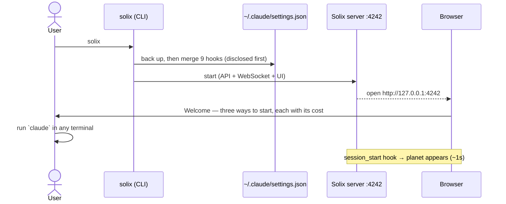
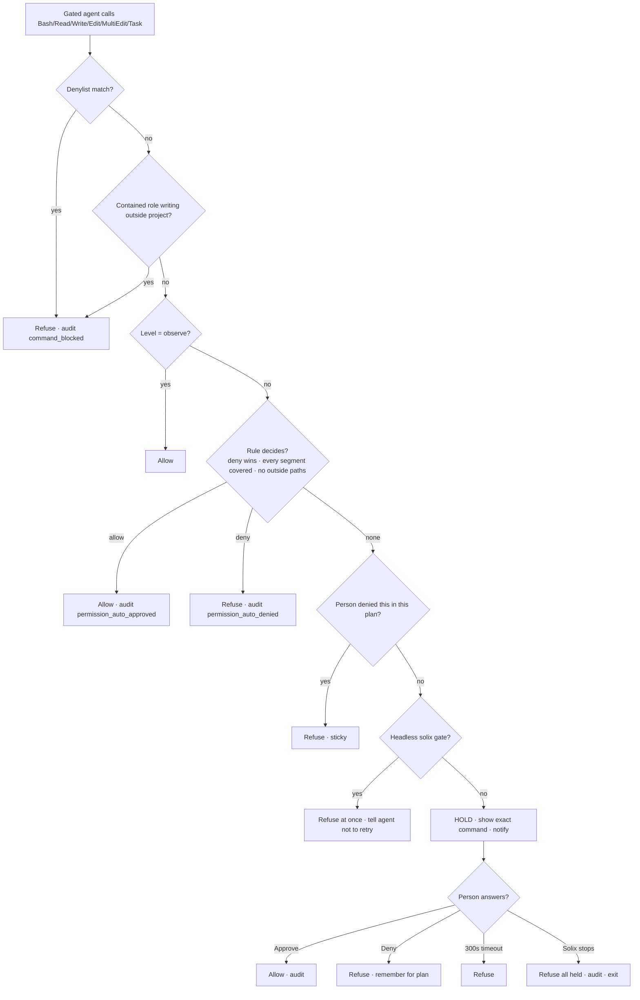
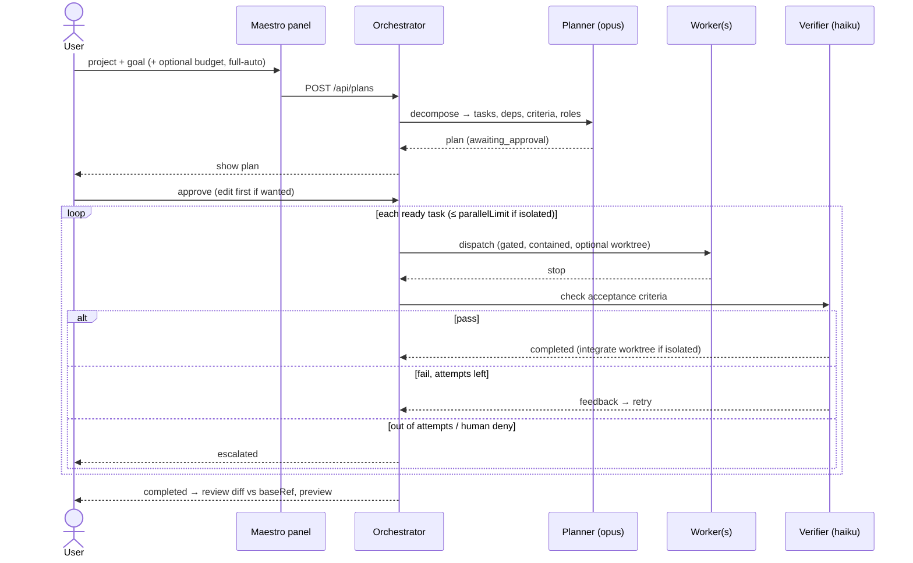
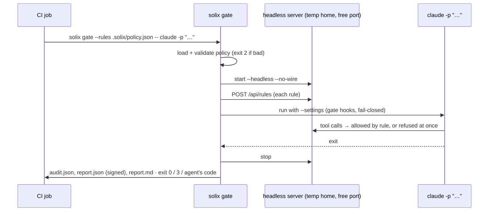

# 05 · User Journeys & Functional Workflows

[← Package index](README.md) · Related: [04 · Feature inventory](04-feature-inventory.md) · [06 · Architecture](06-technical-architecture.md)

Each journey lists its entry point, preconditions, steps, decision points, failure paths and the data involved. "Verified" means the journey has been walked end to end on a real machine; the evidence is cited.

| ID | Journey | Persona | Verified? |
|---|---|---|---|
| J-01 | First run: install → first planet | P1 | Yes. Smoke A1–A4, D1 (1.18.3) |
| J-02 | Watch your own sessions | P1, P5 | Yes. Smoke D1–D3 |
| J-03 | Try it with the demo | new user | Yes. Smoke C1 |
| J-04 | A held decision: approve, deny, timeout, crash | P1, P2 | Yes. Smoke E2–E6 |
| J-05 | Build a goal with Maestro | P2 | Yes, on the eval task (`docs/EVAL.md`) |
| J-06 | Reduce interruptions with rules | P1, P2 | Partly. The eval run used the defaults. "Always allow" from a card is not separately recorded |
| J-07 | Run an agent in CI with `solix gate` | P3 | Yes, on the owner's Mac (2026-11-03). Not yet in a real CI provider |
| J-08 | Produce a record for someone else | P3, P4 | Ledger yes. Report verification by a third party, no |
| J-09 | Schedule a routine | P1 | No |
| J-10 | Upgrade Solix | all | Yes, by the owner on 2026-11-03, with friction (see the failure paths) |

---

## J-01 · First run

- **Entry:** `npm i -g @shmulikdav/solix`, then `solix`.
- **Preconditions:** Node ≥ 20; macOS, Linux or WSL. Claude Code is installed (if not, Solix says so and wires nothing).

**Decision points:**
- The user picks a Welcome option: demo (free), New task (costs money), or watch their own sessions.

**Failure paths:**

| Failure | Behaviour | Evidence |
|---|---|---|
| Port 4242 busy | "nothing was started", with a hint to open the running one or use `--port`. **Doesn't say which version holds the port** | [F-87](04-feature-inventory.md); [R-06](09-risks-and-technical-debt.md#r-06) |
| Claude Code never run (`~/.claude` absent) but installed | Fixed in 1.18.3: both conditions are checked | `docs/E2E-SMOKE-TEST.md` |
| Native Windows | Declines, pointing to WSL | Smoke A7 |
| Malformed `settings.json` | Refuses to merge and explains | `install.ts` |
| A typo (`solix gaet`) | Unknown-command error; nothing starts | `CLAIM-TYPO-NEVER-STARTS` |

**Data:** `~/.claude/settings.json` (plus backup), `~/.solix/` (hooks, `token`, `solix.db`, `secret.key`).

## J-02 · Watch your own sessions

1. The user runs `claude` normally.
2. Hooks POST events.
3. The router creates and updates the session.
4. The transcript watcher computes cost and context.
5. The WebSocket pushes updates to the Galaxy, List, Mission Control and the band.

**Key rule:** the user's own sessions are **observed, not gated**. Solix didn't set their environment.

**Failure paths:**
- **Server down:** hooks fail open within 1 s, and the agent is unaffected.
- **Process killed without a Stop event:** the session stays `active`. This is suspected to inflate the counter ([R-05](09-risks-and-technical-debt.md#r-05)).

**APIs:** `POST /events` (token), WebSocket `session_upsert`; tables `sessions`, `missions`, `tool_calls`.

## J-03 · Demo

`solix demo` seeds about 30 synthetic sessions across 8 projects into a sandboxed demo database, with a "demo" badge. It never touches real data (`CLAIM-DEMO-SEEDS-OR-SAYS`).

## J-04 · A held decision

The core journey of the product.

**Where the person answers:** the Decisions panel (rail → Decisions; keyboard approve/deny keys only when the panel is focused, per smoke E5), the band in Claude Code, or a notification that brings them to the panel. A Decisions card also offers **"Always allow …"**, which writes a rule and approves.

**Failure paths:**
- **Server unreachable:** the fail-closed hook denies.
- **A held request after a restart:** the plan comes back paused (`CLAIM-RESTART-PAUSES-ON-HOLD`).

**APIs:** `POST /events/permission` (the hook blocks on it), WebSocket `permission_request` and `permission_response`, `GET /api/decisions/pending`; tables `audit_events`, `plan_denials`, `approval_rules`.

## J-05 · Build a goal with Maestro

**Decision points:**
- Approve or edit the plan.
- Answer any holds from workers.
- Retry or skip an escalated task.
- Abort (the kill switch).

**Failure paths:**
- **Budget reached:** the plan pauses.
- **A person's deny:** the task escalates instead of retrying.
- **Isolated tasks conflict:** the later one escalates and nothing is merged.
- **Restart:** plans with abandoned holds resume `paused`.

**APIs:** `/api/plans*` (≈20 routes), `/api/plans/:id/review`, `/api/plans/:id/preview`; tables `plans`, `plan_tasks`, `task_thread_entries`, `plan_denials`.

## J-06 · Reduce interruptions with rules

1. `solix rules defaults` (opt-in), or **Always allow** on a Decisions card, or `solix rules add --prefix "…"`.
2. Fleet → **Rules** shows the rules with their hit counts, and lets you disable or delete them.
3. `solix ledger` suggests a rule for something approved repeatedly.
4. `solix rules test "<command>"` explains what the gate would do.

**Failure modes by design:**
- A rule can never override the denylist.
- An allow rule can never cover a path outside the project.

## J-07 · CI with `solix gate`

**Verified:** on macOS with a real `claude` (2026-11-03). Three successive runs showed the policy-authoring friction, which led to `solix rules test` and policy `extends`.

**Not verified:** a real hosted CI provider (GitHub Actions etc.). See [Q-07](10-decisions-and-open-questions.md#q-07).

## J-08 · Produce a record

- `solix ledger --md` or `--csv` exports the decisions in a window, with "worth a second look" insights.
- `solix report --format json --out f.json` produces a signed report. `solix report --verify f.json` checks it.
- Optional: `solix reporting enable` sends decision records to a company endpoint.

**Limitation:** a report proves who produced it and that it hasn't been edited, **not** that nothing happened outside the hooks.

## J-09 · Schedule a routine

Fleet → **Routines** (or `solix schedules add`):

1. Choose a prompt and an interval, webhook or manual trigger.
2. The cost estimate is shown before enabling.
3. Runs are recorded.
4. **Edit** keeps the history and the token.

Routines run under the denylist; at `strict`, they are also held. **Not verified end to end.**

## J-10 · Upgrade

1. `npm i -g @shmulikdav/solix`.
2. `solix start`. It updates the installed hooks ("hooks are from X — updating to Y").
3. **Restart the running server.** There is no `solix stop` command.

**Failure paths observed on 2026-11-03:**
1. **The old server keeps running.** A new `solix` says "port in use", and the UI shows the old version. The user has to `kill` the old process. → [B-06](08-backlog-and-roadmap.md#b-06)
2. **Native module ABI mismatch** after switching Node versions in a source checkout (`better-sqlite3`). Fixed with `pnpm rebuild -r better-sqlite3`. → [R-16](09-risks-and-technical-debt.md#r-16)
3. **A stale browser tab.** The UI shows an update banner when the server is newer than the page (`UpdateBanner.tsx`).
