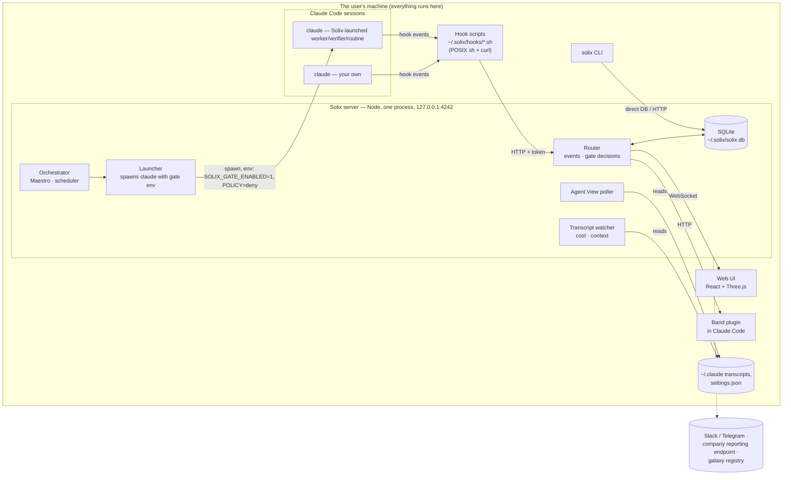
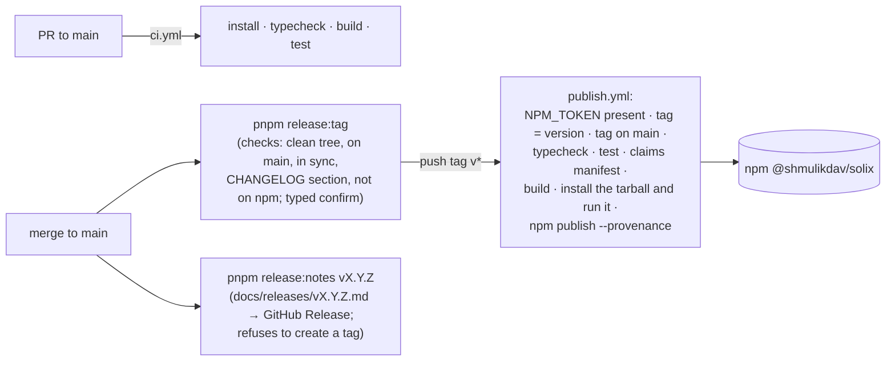

# 06 · Technical Architecture & Integrations

[← Package index](README.md) · Related: [03 · PRD §9 Data model](03-complete-prd.md#9-data-model--business-logic) · [09 · Risks](09-risks-and-technical-debt.md)

A PM-level map of how Solix is built, and which architectural choices constrain the roadmap. Items marked **⚠ confirm** are inferences an engineer should check.

## 1. The shape in one picture

**The key architectural fact:** Solix is a **local sidecar**. It has no cloud backend, no accounts and no multi-tenancy, and it only "governs" an agent whose environment it controlled when that agent started. Every growth direction runs into this:

- **multi-user** needs shared state and identity;
- **Teams** needs a server;
- **governing your own sessions** needs opt-in env.

## 2. Technology stack

| Layer | Technology | Evidence |
|---|---|---|
| Language | TypeScript 5.4 (strict), ESM, Node ≥ 20 | `tsconfig.base.json`, `packages/cli/package.json` |
| Monorepo | pnpm 9 workspaces: `shared`, `server`, `web`, `cli` (plus `agents`, `skills` content) | `pnpm-workspace.yaml` |
| Server | Hono 4 on `@hono/node-server`, `ws` WebSocket, `better-sqlite3` 11 | `packages/server/package.json` |
| Web | React 18, Vite 5, Zustand, Three.js 0.168 with React Three Fiber, drei and postprocessing, Tailwind | `packages/web/package.json` |
| CLI | Commander 12, `node-pty` (for `solix run`), `open`; bundled with tsup | `packages/cli/package.json`, `tsup.config.ts` |
| Hooks | POSIX shell plus `curl` | `packages/cli/hooks/*.sh` |
| Tests | Vitest (1,372 tests / 125 files), Playwright for browser smoke | `vitest.config.ts`, `scripts/smoke-browser.mjs` |
| Distribution | One npm package, `@shmulikdav/solix`. The other packages are bundled into it | `.github/workflows/publish.yml` |

## 3. Components

| Component | Responsibility | Key code |
|---|---|---|
| **Hooks** | Translate Claude Code lifecycle events into HTTP posts. `pre-tool-*` hooks block when the gate is on | `packages/cli/hooks/` |
| **Router** | Ingest events; maintain sessions, missions and tool calls; **decide gated calls** (floor → level → rules → sticky → hold) | `packages/server/src/router.ts` |
| **Containment** | The denylist floor; confinement of file writes for contained roles | `packages/server/src/containment.ts` |
| **Rules engine** | Parse shell commands into segments and paths; match rules | `packages/shared/src/approvalRules.ts`, `packages/server/src/state/rules.ts` |
| **Launcher** | Spawn `claude` sessions with the gate env, budget, worktree, and granted secrets; optional sandbox wrapper | `packages/server/src/launcher.ts` |
| **Orchestrator** | Maestro planning, dispatch, verification, retry, parallelism, integration; routine scheduling | `packages/server/src/orchestrator/` |
| **State modules** | 32 modules, one per domain (plans, rules, audit, ledger, report, reporting, …) | `packages/server/src/state/` |
| **HTTP API** | 115 routes: `/events*` for hooks, `/api/*` for the UI and CLI | `packages/server/src/http.ts` |
| **WebSocket** | Pushes state to the UI; receives permission responses and launches | `packages/server/src/ws.ts` |
| **Web UI** | Shell (rail, top bar, command palette), the Galaxy scene, HUD (Decisions, List, Missions, Timeline), panels (Maestro, Fleet tabs, Share, Session, Advisor, Skill) | `packages/web/src/` |
| **CLI** | About 60 commands: lifecycle, governance, records, configuration | `packages/cli/src/index.ts` |
| **Plugins** | `solix-crew` (advisors as Claude Code subagents, standalone) and `solix-band` (in-prompt status and approvals) | `plugin/` |

## 4. APIs

| Surface | Consumers | Auth |
|---|---|---|
| `POST /events`, `/events/permission`, `/events/codex` | Hook scripts | `X-Solix-Token` from `~/.solix/token` |
| `/api/*` (≈110 routes) | Web UI, CLI, band | Loopback bind, plus `Host` and `Origin` checks |
| WebSocket `/ws` | Web UI | `Origin` and `Host` checks |
| `POST /api/triggers/:token` | External webhooks firing routines | Unguessable per-routine token |

API routes with **no UI caller** (CLI- or plugin-only, or unused): galaxy publish and registry, `/api/missions`, `/api/impact`, `/api/decisions/pending`, `/api/band`, `/api/system/governance` and others. **⚠ confirm** which of these are intentionally CLI-only.

There is **no versioned public API** and no API documentation beyond the code.

## 5. Integrations

| Integration | Direction | Default | Code |
|---|---|---|---|
| Claude Code hooks and `--settings` | in | on | `install.ts`, `gate.ts` |
| Claude Code transcripts (`~/.claude/projects/…/*.jsonl`) | read | on | `state/transcript.ts` |
| Claude Code Agent View (`~/.claude/daemon`, `~/.claude/jobs`) | read, polled every 3 s | on (`SOLIX_DISABLE_AGENTVIEW=1` turns it off) | `state/agentview.ts` |
| `claude` CLI (spawned) | out | used by Maestro, New task, routines | `launcher.ts` (`SOLIX_CLAUDE_BIN` overrides) |
| Codex CLI | in/out | experimental | `codex.ts` (`SOLIX_CODEX_BIN`) |
| Slack, Telegram | out | off until configured | `state/notifiers.ts` |
| Company reporting endpoint (`https://` or `file:`) | out | off | `state/reporting.ts` |
| Galaxy registry (`SOLIX_REGISTRY_URL`) | out | off. **No known registry exists** | `cloud.ts` |
| Galaxy import from URL | out | on demand, SSRF-guarded | `http.ts` |
| git (worktrees, diff, integrate) | local | used by Maestro | `state/git.ts`, `state/worktrees.ts` |
| GitHub issues ("Report a problem") | browser link | on demand, payload shown first | `shell/ReportProblem.tsx` |

## 6. Background and asynchronous processing

| Process | Cadence | Notes |
|---|---|---|
| Routine scheduler heartbeat | ~30 s | `create.ts` |
| Agent View sync | 3 s poll plus file watch | `state/agentview.ts` |
| Transcript watching | File-watch per session | `state/transcript.ts` |
| Orchestrator advance | Event-driven: on worker stop, verify, approve | `orchestrator/index.ts` |
| Startup recovery | Once | Clears stale permission holds; pauses plans with abandoned holds; cleans worktrees. **Doesn't sweep stale `active` sessions** ([R-05](09-risks-and-technical-debt.md#r-05)) |
| Reporting push | Manual (`solix reporting push`), or **⚠ confirm** whether any automatic cadence exists | `state/reporting.ts` |

There is **no job queue and no worker pool.** Everything runs in one Node process.

## 7. Security mechanisms

Details and limits are in [`docs/THREAT-MODEL.md`](../THREAT-MODEL.md); mechanics are in [`SECURITY.md`](../../SECURITY.md).

| Mechanism | Purpose |
|---|---|
| Loopback bind; `Host` allow-list (`SOLIX_ALLOWED_HOSTS`); `Origin` checks on HTTP and WebSocket | Stop remote pages and DNS-rebinding from reading or driving the local API |
| Ingestion token (`~/.solix/token`, mode 0600) | Stop other local processes from forging events or answering holds |
| Fail-closed gate env for launched agents | An outage or timeout never allows |
| Denylist floor | Catastrophic commands refused regardless of settings |
| Path-aware rule matcher | Allow rules confined to the project and scratchpad |
| AES-256-GCM secrets with a local key (`~/.solix/secret.key`) | Credentials at rest; values never returned by the API |
| Env scrub and sandbox wrapper (`SOLIX_ENV_SCRUB`, `SOLIX_SANDBOX_CMD`) | Optional isolation for launched agents |
| ed25519 signed, hash-chained reports | Tamper-evidence for records |

## 8. Deployment, release and CI/CD

There is **no hosted deployment.** Users install from npm and run locally.

| Fact | Detail |
|---|---|
| CI | `.github/workflows/ci.yml` on every PR and on pushes to `main`. Node 20 |
| Publish | `.github/workflows/publish.yml` on a `v*` tag. Needs the `NPM_TOKEN` repository secret. Publishes with npm provenance |
| Release notes | `docs/releases/v*.md`, published by `scripts/publish-release-notes.mjs` from a machine with `gh` authenticated |
| Website | **Outside this repository.** Hosting, source and deploy access unknown ([Q-06](10-decisions-and-open-questions.md#q-06)) |

## 9. Architectural decisions and their implications

| Decision | Implication for the roadmap |
|---|---|
| **Local-only, single process, SQLite** ([D-01](10-decisions-and-open-questions.md#d-01)) | Simple, private, zero-ops. But no shared state, so multi-user and Teams require new architecture (a server, identity, storage adapters) |
| **Govern by setting the agent's env at launch** | Sessions the user starts aren't gated unless they opt in. A "governs everything" pitch would be false |
| **Gate via Claude Code hooks** | Solix sees only tool calls routed to the hooks: `Bash`, `Read`, `Write`, `Edit`, `MultiEdit`, `Task`. `Glob`, `Grep`, `WebFetch`, `WebSearch`, `NotebookEdit` and MCP tools are **not** routed. It also depends on Anthropic's hook contract ([R-08](09-risks-and-technical-debt.md#r-08)) |
| **Static command parsing, not a sandbox** ([D-10](10-decisions-and-open-questions.md#d-10)) | Rules can only judge the command text. Real isolation must come from containers or `SOLIX_SANDBOX_CMD` |
| **The claims ledger** (every public promise bound to a failing-if-false test) ([D-05](10-decisions-and-open-questions.md#d-05)) | High trust and a high bar. New claims cost a test each, which slows marketing copy, deliberately |
| **One npm package bundling everything** | One install. But native modules (`better-sqlite3`, `node-pty`) tie it to Node ABI compatibility ([R-16](09-risks-and-technical-debt.md#r-16)) |
| **The audit log is the reporting queue** | No outbox drift. Reporting depends on the audit table's integrity |
| **The verifier runs on every task** | Quality, at about 3× the cost of plain Claude Code (`docs/EVAL.md`) |

## 10. Assumptions requiring engineering confirmation

1. The server is safe to run on a shared multi-user host (the token and Host checks were designed for a single-user machine). **⚠ confirm**
2. The behaviour of Claude Code's hooks when a hook returns `allow` for a tool Claude Code itself would prompt for: is Claude Code's own prompt bypassed in every case? The threat model assumes yes. **⚠ confirm against the current Claude Code release**
3. The database migration strategy handles downgrades. There is no evidence either way. **⚠ confirm**
4. The minimum Claude Code version that supports everything used. Not stated ([Q-08](10-decisions-and-open-questions.md#q-08)).
