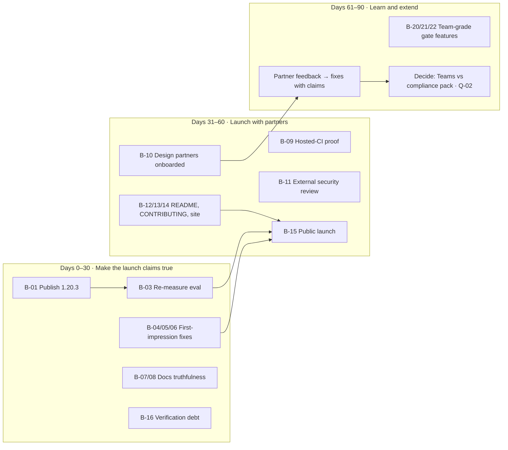

# 08 · Product Backlog & Recommended Roadmap

[← Package index](README.md) · Related: [07 · Current status](07-current-status.md) · [09 · Risks](09-risks-and-technical-debt.md) · [10 · Decisions & questions](10-decisions-and-open-questions.md)

**Origin labels:**
- **[Agreed]**: agreed with the owner in the 2026-11 working sessions (the launch plan and the 1.20 / 1.21 roadmap). These are not written into a repository document, so confirm them ([Q-03](10-decisions-and-open-questions.md#q-03)).
- **[Documented]**: in a repository document.
- **[Recommended]**: this audit's recommendation, not approved by anyone.

**No effort estimates are given.** None exist in the repository, and inventing them would mislead. Where scope is small and well understood, that is said in words.

---

## P0: critical blockers and urgent risks

### B-01 · Publish 1.20.3 · [Agreed]
- **Problem:** The default approval rules in the published 1.20.2 still let an agent read `~/.ssh/id_ed25519` and reach outside the project through `$HOME`, `..`, option values and `<( )` without asking. The fix is merged but unpublished.
- **Impact:** Closes a real security exposure for everyone using `solix rules defaults` or `solix gate`.
- **Dependencies:** The maintainer's machine; the npm token in CI.
- **Status:** Merged (PR #55).
- **Acceptance:** `npm view @shmulikdav/solix version` → `1.20.3`; the GitHub Release `v1.20.3` renders; `solix rules test --rules defaults "cat \$HOME/.ssh/id_ed25519"` exits 1 on an upgraded install.
- **Next action:** The maintainer runs `pnpm release:tag`, then `pnpm release:notes v1.20.3`, on `main`.

### B-03 · Re-measure the evaluation on a real machine · [Agreed] (launch gate 2)
- **Problem:** The headline number (holds 30 → 4) predates the scratchpad and path-confinement changes. The path work (1.20.3) may **increase** holds, because commands touching paths outside the project are no longer auto-allowed.
- **Impact:** Every launch claim rests on it.
- **Dependencies:** A machine with a real `claude`; B-01.
- **Status:** Not started.
- **Acceptance:** `docs/EVAL.md` and the next release notes carry a fresh run (holds, rule decisions, cost, wall, interventions, result) on 1.20.3, with the "pending re-measure" note removed.
- **Next action:** `SOLIX_EVAL_DIR=/tmp/solix-eval scripts/eval/run.sh` against an installed 1.20.3.

## P1: high-value or essential

### B-04 · Retire sessions whose process has died · [Agreed] (launch gate 3)
- **Problem:** "17 active" is shown among 481 sessions. Nothing moves an `active` session to idle when its process is gone. Suspected, not confirmed ([R-05](09-risks-and-technical-debt.md#r-05)).
- **Acceptance:** Given a session marked active whose PID no longer exists, when Solix starts (and periodically after), then it is marked idle and the top-bar count drops.
- **Next action:** Confirm with `pgrep -fl claude | wc -l` against the count; then implement a liveness sweep, as already done for stale permission holds in `router.ts`.

### B-05 · A readable Galaxy at scale · [Agreed] (launch gate 3)
- **Problem:** With hundreds of past sessions, idle planets dominate and labels are unreadable. That is the first impression for any existing Claude Code user who runs `solix import`.
- **Acceptance:** With more than N idle sessions (N to be decided), idle sessions are hidden by default with a visible toggle, and active or needs-attention sessions stay legible.

### B-06 · Upgrade without a manual kill · [Agreed] (launch gate 3)
- **Problem:** "port 4242 is already in use" doesn't say that an older Solix holds the port. There is no `solix stop`.
- **Acceptance:** The message names the running version and its PID, and gives the one-line replacement. Optional: `solix stop` or `solix restart`.

### B-07 · Correct the stale claim text · [Recommended]
- **Problem:** `docs/CLAIMS.md` says the parallel limit defaults to 1. The code says 2. The project's own rule is that a false public statement is a defect.
- **Acceptance:** The claim text matches the code. A small change.

### B-08 · Retire or rewrite the v1.7-era long-form docs · [Recommended]
- **Problem:** `CLI.md`, `OPERATING.md`, `SOLIX_DOCS_BUNDLE.md` and `DEMO_DEV.md` describe a product without Maestro, rules, levels or the gate.
- **Acceptance:** Each is either rewritten for 1.20, or moved under `docs/archive/` and marked historical.

### B-09 · Prove `solix gate` in hosted CI · [Recommended]
- **Problem:** The CI story has been verified on a laptop only.
- **Acceptance:** A GitHub Actions workflow in a sample repository runs the documented `docs/GATE.md` snippet. It passes for a covered task and exits 3 for an uncovered one. The artifact is uploaded.

### B-10 · Design-partner loop · [Agreed] (1.21) · [Documented] as the #3-ranked revenue move
- **Problem:** No known external users.
- **Acceptance:** At least three external teams running Solix for two weeks or more. Each "moment I stopped trusting it" becomes a changelog entry with a test.
- **Dependencies:** B-01, B-03, B-12.

### B-11 · Independent security review of the gate and rule matcher · [Recommended]
- **Problem:** Three security fixes to the rules shipped in one day. All were found internally.
- **Acceptance:** An external reviewer probes the gate, rules and API with the threat model as scope. Each finding is fixed with a claim.

### B-12 · README pitch rewrite · [Agreed] (launch gate 4)
- **Problem:** The README leads with the galaxy and advisors. The verified value is the gate.
- **Acceptance:** It opens with the agreed sentence, includes the three agreed screenshots (the hold card with the exact command, the ledger, the review diff), and links the threat model.

### B-13 · `CONTRIBUTING.md` · [Agreed] (1.21)
- **Acceptance:** Explains verify-to-fail, the claims ledger, how to run the eval, and the release process.

### B-14 · Website refresh for 1.20.x · [Agreed] (launch gate 4)
- **Dependencies:** Access to the website source and hosting ([Q-06](10-decisions-and-open-questions.md#q-06)); previously blocked on a Cloudflare credential.
- **Acceptance:** The site shows 1.20.x, the gate-first pitch, `solix gate`, and the threat model link.

### B-15 · Launch · [Agreed] (1.21)
- **Acceptance:** A post (Show HN / r/ClaudeAI) built on the measured three-column table: Solix vs plain Claude Code vs Paperclip.
- **Dependencies:** B-01, B-03, B-04–B-06, B-12, B-14.

### B-16 · Pay down verification debt · [Recommended]
- **Problem:** 33 features are tested but never verified end to end. Several have manual checks written and never run: E9–E11 (sticky deny, restart pause, downgrade), G1–G5 (budget), H1–H3 (worktrees), K5 (kill switch), L1–L3 (routines), M1–M3 (secrets).
- **Acceptance:** Each listed check is run against the published build and recorded in `docs/E2E-SMOKE-TEST.md`. Statuses in [04](04-feature-inventory.md) are updated.

## P2: important improvements

| ID | Item | Problem | Origin | Status | Acceptance (summary) |
|---|---|---|---|---|---|
| B-20 | **Several people at the gate** | One desk; no attribution | [Agreed] 1.20 roadmap | Planned | Decisions claimable and attributed to a named person; notifications carry the command; approvals stay local |
| B-21 | **`solix status` for agents** | Agents retry blind when refused or over budget | [Agreed] | Planned | An agent can read its remaining budget, its context %, and the rules in force |
| B-22 | **Ledger and audit JSON / SIEM export** | Team dashboards, compliance | [Agreed] / [Documented] | Planned | `solix ledger --json`; a documented SIEM format |
| B-23 | **Codex human hold** | Second runtime ungated | [Agreed] / [Documented] | **Blocked** on running `docs/CODEX-PROBE.md` against a real `codex` | Probe result recorded; a deny-only floor at minimum |
| B-24 | **Database backup and retention** | The DB grows without bound; no backup guidance; losing `secret.key` loses secrets | [Recommended] | — | A documented backup procedure; an optional retention window |
| B-25 | **Price-table maintenance** | Hard-coded Anthropic prices drift | [Recommended] | — | A documented update process, plus a "prices as of" date shown in the UI |
| B-26 | **List virtualisation; basic responsive layout** | Scale; mobile | [Documented] gap | — | List stays smooth at 1,000 sessions; the core panels are usable at phone width |
| B-27 | **Org scoping for routines** | Tenancy incomplete | [Documented] gap | — | Routines scoped by org like plans and goals |

## P3: optional or longer-term

| ID | Item | Origin | Status | Note |
|---|---|---|---|---|
| B-30 | **Solix Teams server** (proprietary) | [Documented] `TEAMS-SPEC.md` | Planned | Gated on the business decision [Q-02](10-decisions-and-open-questions.md#q-02) and on design-partner evidence |
| B-31 | Postgres / S3 storage adapters | [Documented] | Planned | Only meaningful with B-30 |
| B-32 | Distribution: Homebrew tap, plugin marketplace manifest, `doctor --json` | [Agreed] 1.21 | Planned | |
| B-33 | Native Windows | — | Unknown | Decide yes or no ([Q-05](10-decisions-and-open-questions.md#q-05)) |
| B-34 | Delete or salvage the 8 stale branches | [Recommended] | — | [Q-13](10-decisions-and-open-questions.md#q-13) |
| B-35 | Galaxy registry: build a UI and a service, or remove the dormant half | [Recommended] | — | It follows the precedent of removing dormant licensing ([D-02](10-decisions-and-open-questions.md#d-02)) |

---

## Indicative roadmap

**Not a commitment.** No dates have been approved and no estimates exist. The sequence follows the agreed launch gates.

| Window | Theme | Exit criterion |
|---|---|---|
| **0–30 days** | Make every launch claim true | 1.20.3 published; a fresh eval number published; galaxy and session count trustworthy; no stale public docs |
| **31–60 days** | Launch to design partners, then publicly | ≥3 partner teams installed; the launch post live; CI proven in GitHub Actions |
| **61–90 days** | Learn from real use | Partner findings turned into claims; a decision on the business path (Teams server vs compliance pack vs services) |
