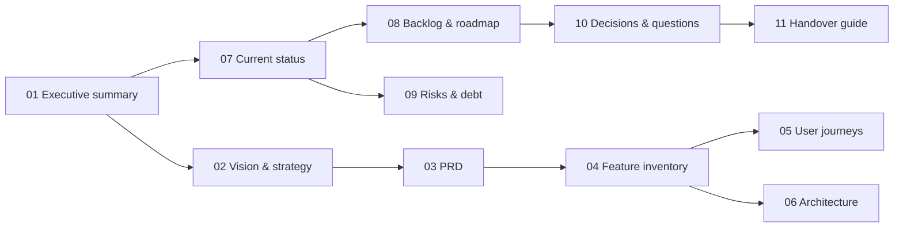

# Solix — Product Handover Package

**Prepared:** 2026-11-03 · **Product version at time of writing:** `@shmulikdav/solix` **1.20.2** on npm; **1.20.3** merged to `main` (PR #55) and waiting to be published.
**Prepared by:** an audit of the repository (code, tests, git history, CI, docs) plus the record of the working sessions in which 1.19–1.20.3 were built.
**Audience:** a Product Manager taking over Solix with no prior context.

> **How to read the statuses in this package.** Statuses are deliberately conservative. **Completed & Verified** means there is recorded evidence of the feature working end to end on a real machine: a manual end-to-end run, an evaluation run, or the owner's own runs. Automated tests alone earn **Implemented, Not Verified**, however many there are. The definitions are in [04 · Feature inventory](04-feature-inventory.md#status-definitions).

---

## Start here

| If you have… | Read |
|---|---|
| 5 minutes | [11 · PM handover guide § A](11-pm-handover-guide.md#a-product-overview-in-5-minutes) |
| 30 minutes | [01 · Executive summary](01-executive-summary.md), then [07 · Current status](07-current-status.md) |
| A morning | Everything below, in order |
| A decision to make | [10 · Decisions & open questions](10-decisions-and-open-questions.md) |

## The documents

| # | Document | What it answers |
|---|---|---|
| 01 | [Executive summary](01-executive-summary.md) | What Solix is, for whom, how mature it is, what to do first. Written for a non-technical reader. |
| 02 | [Product vision & strategy](02-product-vision-and-strategy.md) | Vision, problem, positioning, business model, success measures. Documented strategy is kept separate from inferred strategy. |
| 03 | [Complete PRD](03-complete-prd.md) | Users and personas, use cases, functional requirements (`FR-*`), non-functional requirements (`NFR-*`), data model, analytics. |
| 04 | [Feature inventory](04-feature-inventory.md) | Every capability (`F-*`), with status, evidence, gaps and code references. |
| 05 | [User journeys](05-user-journeys.md) | The end-to-end flows (`J-*`), with diagrams and failure paths. |
| 06 | [Technical architecture](06-technical-architecture.md) | The stack, components, integrations, security mechanisms, and the architectural decisions that constrain the roadmap. |
| 07 | [Current status](07-current-status.md) | What is done, in progress, still to do, and unknown. |
| 08 | [Backlog & roadmap](08-backlog-and-roadmap.md) | Prioritised backlog (`B-*`, P0–P3) and an indicative 30/60/90-day plan. |
| 09 | [Risks & technical debt](09-risks-and-technical-debt.md) | Defects, risks and debt (`R-*`), each with severity and mitigation. |
| 10 | [Decisions & open questions](10-decisions-and-open-questions.md) | Recovered decisions (`D-*`) and the questions (`Q-*`) only a human can answer. |
| 11 | [PM handover guide](11-pm-handover-guide.md) | Overview, what to know immediately, a first-30-days plan, interview questions, and a knowledge map. |

## Identifier scheme

| Prefix | Meaning | Defined in |
|---|---|---|
| `F-nn` | Feature / capability | [04](04-feature-inventory.md) |
| `J-nn` | User journey | [05](05-user-journeys.md) |
| `FR-xxx-nn` | Functional requirement | [03 § 6](03-complete-prd.md#6-functional-requirements) |
| `NFR-nn` | Non-functional requirement | [03 § 7](03-complete-prd.md#7-non-functional-requirements) |
| `B-nn` | Backlog item | [08](08-backlog-and-roadmap.md) |
| `R-nn` | Risk / defect / debt item | [09](09-risks-and-technical-debt.md) |
| `D-nn` | Recovered decision | [10](10-decisions-and-open-questions.md#part-1--decisions) |
| `Q-nn` | Open question | [10](10-decisions-and-open-questions.md#part-2--open-questions) |
| `CLAIM-*` | A public promise bound to a test that fails if the promise breaks | [`docs/CLAIMS.md`](../CLAIMS.md) |

## Sources used, and sources not available

**Used:**
- the repository at `main` `9091b59`, including `CHANGELOG.md`, every file under `docs/`, the source of all four packages and their 125 test files, and `.github/workflows/`;
- git history: 299 commits, 40 tags and 11 remote branches;
- GitHub pull requests #1–#55;
- the npm registry;
- the evaluation record (`docs/EVAL.md`);
- the manual end-to-end test record (`docs/E2E-SMOKE-TEST.md`);
- the record of the 2026-11 working sessions in which 1.19–1.20.3 were planned and built.

**Not available, and therefore not used:**
- the marketing website's source and hosting (it lives outside this repository);
- any issue tracker beyond GitHub, which has **zero issues**;
- any customer, partner or usage data. Solix has no telemetry by design.

Anything that depends on these sources is marked **Unknown / Requires Validation**.

## Confidentiality

This package contains no credentials, tokens or personal data. Environment variable **names** appear because they are part of the product's interface; no values do.
