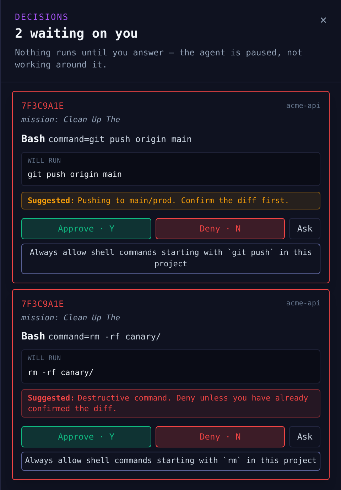

# Solix

> The control layer for your coding agents — 100% local.

[](https://www.npmjs.com/package/@shmulikdav/solix)
[](https://www.npmjs.com/package/@shmulikdav/solix)
[](https://github.com/shmulikdav/Solix/blob/main/LICENSE)
[](https://nodejs.org)

**Build with agents that have to ask first.**

Solix holds every risky command from the Claude Code agents it launches until a
person approves it, with the exact command in front of you. It can plan a goal
into tasks, run one agent per task, check each result and hand you the diff,
and it shows every session on your machine with what it costs. No account, no
telemetry.

<p align="center">
  
</p>

## Install

```sh
npm i -g @shmulikdav/solix
solix            # wires the Claude Code hooks, then opens http://127.0.0.1:4242
solix demo       # or: a full synthetic galaxy in a sandbox, nothing real touched
```

macOS, Linux, or Windows through WSL. Node 20 or later, and Claude Code. First
run says what it will write to `~/.claude/settings.json` and backs it up first;
`solix uninstall` takes out only Solix's own hooks.

**Upgrading:** `npm i -g` updates the command, but a running server keeps the old
version. Restart it with `solix stop && solix`.

## The gate, in four commands

```sh
solix rules defaults                          # stop being asked about routine work
solix rules test "cat ~/.ssh/id_ed25519"      # what would the gate decide, and why
solix ledger                                  # what you allowed, and when
solix gate --rules policy.json -- claude -p "Run the tests"   # CI: nobody at the gate
```

The denylist (`rm -rf /`, `curl … | sh`, `sudo`, writes to SSH keys) refuses at
every level and no rule overrides it. A `claude` session you start yourself is
shown and costed but not held, unless you export `SOLIX_GATE_ENABLED=1` before
starting it.

Rules are standing decisions, not a sandbox: allowing `npm test` allows whatever
your tests do. The threat model says what the gate guarantees and where the
real boundary is.

**New task, Maestro and routines run Claude on your account** and spend real
money. Give a Maestro plan a budget cap and it pauses before spending past it.

Every command has `--help`. `solix doctor` checks the install.

## Docs

- [README](https://github.com/shmulikdav/Solix#readme): the gate, Maestro, install, what it writes
- [Threat model](https://github.com/shmulikdav/Solix/blob/main/docs/THREAT-MODEL.md): what the gate guarantees, and what it does not
- [`solix gate` in CI](https://github.com/shmulikdav/Solix/blob/main/docs/GATE.md)
- [Claims](https://github.com/shmulikdav/Solix/blob/main/docs/CLAIMS.md): every public claim, and the test that fails when it stops being true
- [Changelog](https://github.com/shmulikdav/Solix/blob/main/CHANGELOG.md)

Security problems: report privately at
<https://github.com/shmulikdav/Solix/security/advisories/new>, never in a public issue.

## License

MIT.
